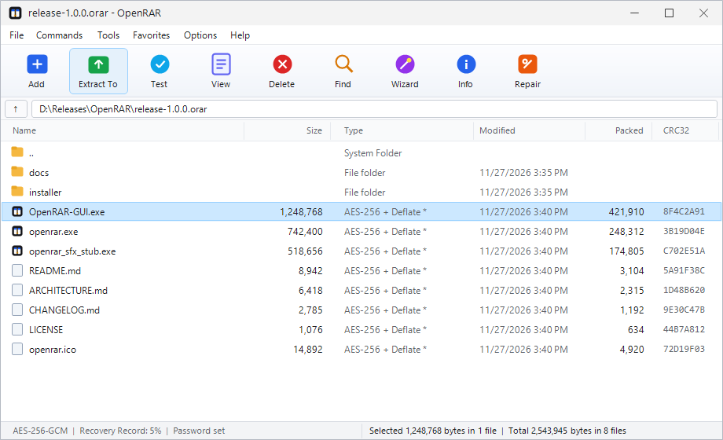

<p align="center">
  
</p>

<h1 align="center">OpenRAR</h1>

<p align="center">
  Fast, zero-dependency, open-source C++20 archiver for Windows, Linux, and macOS.
  <br/>
  <a href="https://miladinovst.github.io/OpenRAR/"><strong>Project Website</strong></a> &middot;
  <a href="https://github.com/miladinovst/OpenRAR/releases/latest"><strong>Download v1.0.0</strong></a> &middot;
  <a href="https://github.com/miladinovst/OpenRAR/issues"><strong>Report Bug</strong></a>
</p>

<p align="center">
  
  
  
  
  
</p>

<p align="center">
  
</p>

---

## Overview

OpenRAR is a clean-room, open-source C++20 file archiver with **zero external build dependencies**. It combines a fast multi-threaded compression engine, AES-256-GCM encryption, encrypted filenames (`-hp`), interleaved parity recovery records (`-rr`) for corruption repair, split volumes, standalone self-extracting executables (SFX), recursive search inside archives, and full ZIP64 / AE-2 interoperability.

It ships as four modular CMake targets:
- **`openrar_core`**: Portable static C++20 library (Windows, Linux, macOS).
- **`openrar`**: Cross-platform command-line interface.
- **`openrar_sfx_stub`**: Standalone Self-Extracting Archive stub.
- **`OpenRAR-GUI.exe`**: Native Win32 desktop GUI on Windows (zero framework bloat, ~830 KB full release bundle).

---

## Supported Formats

| Format | Create | Extract | List / Browse | Test | Encrypt | Repair | Split Volumes |
| :--- | :---: | :---: | :---: | :---: | :---: | :---: | :---: |
| **OpenRAR (`.orar`)** | Yes | Yes | Yes | Yes | AES-256-GCM + `-hp` | Yes (Parity RR) | Yes (`.partN.orar`) |
| **ZIP / ZIP64 (`.zip`)** | Yes | Yes | Yes | Yes | AE-2 AES-256 / ZipCrypto | Yes (Header salvage) | Yes (`.partN.zip`) |
| **7-Zip (`.7z`)** | Yes | Yes | Yes | Yes | Extract (`7z`) | No | No |
| **RAR4 / RAR5 (`.rar`)** | Optional (`rar`) | Yes | Yes | Yes | Extract (`unrar`/`7z`) | No | No |
| **TAR / TAR.GZ (`.tar`, `.tgz`)** | Yes | Yes | Yes | Yes | No | No | No |
| **TAR.XZ / TAR.BZ2 / TAR.ZST** | No | Yes | Yes | Yes | No | No | No |
| **GZip / CAB / ISO** | No | Yes | Yes | Yes | No | No | No |

---

## Key Features

- **High-Speed Native Compression Engine**
  - RFC 1951 Deflate with Canonical Dynamic Huffman (type 2), Fixed Huffman (type 1), Stored auto-fallback, lazy LZ77 matching, and O(1) length/distance lookup tables.
  - 9-bit O(1) lookup-table Inflate decoder for fast extraction and integrity verification.
  - Multi-threaded per-file compression across all CPU cores (2,600+ MB/s measured on 24 threads).
  - Full ZIP64 (>4 GB / >65,535 entries) and standard AE-2 AES-256 encrypted ZIP interoperability.
- **Cryptography and Security**
  - AES-256-GCM authenticated encryption with PBKDF2-HMAC-SHA256 key derivation and optional header/filename encryption (`-hp`).
  - Per-file CRC32 + SHA-256 verification, constant-time MAC comparisons, full UTF-8 filename support, and Zip-Slip path traversal protection.
- **Recovery Records (`-rr`)**
  - Interleaved 512-byte sector CRCs and XOR parity stripes reconstruct bit flips and contiguous burst corruptions in `.orar` archives bit-for-bit.
- **Native Windows Desktop GUI (`OpenRAR-GUI.exe`)**
  - 9-button GDI+ toolbar (`Add`, `Extract To`, `Test`, `View`, `Delete`, `Find`, `Wizard`, `Info`, `Repair`).
  - Hierarchical folder browsing inside archives, drag-and-drop, right-click menus, non-blocking Live Progress dialog (MB/s + Cancel), persistent Favorites and window geometry, live 13-language switcher (`Options -> Language`), and per-user (`HKCU`) cascading Windows Explorer right-click integration (`OpenRAR >`).
- **13 Built-In Languages**
  - Automatic OS locale detection on startup, live GUI switching (`Options -> Language`), and CLI `--lang=<code>` / `OPENRAR_LANG`:
  - English (`en`), Chinese (`zh`), Spanish (`es`), Hindi (`hi`), Arabic (`ar`), Portuguese (`pt`), Indonesian (`id`), French (`fr`), Japanese (`ja`), Russian (`ru`), Serbian (`sr`), Croatian (`hr`), Bosnian (`bs`).

---

## Installation & Setup

### Windows
1. **Installer / Portable Release**: Download `OpenRAR-Setup-1.0.0-win64.exe` (Inno Setup wizard) or `OpenRAR-1.0.0-win64.zip` from GitHub Releases.
2. **Per-User PowerShell Installer (No Admin Required)**:
   ```powershell
   # Installs to %LOCALAPPDATA%\OpenRAR, adds to user PATH, creates Start Menu/Desktop shortcuts,
   # registers the Windows Explorer right-click menu, and adds an Installed Apps uninstall entry
   .\installer\windows\install.ps1

   # Cleanly uninstall at any time
   .\installer\windows\uninstall.ps1
   ```
3. **Package a Local Windows Release**:
   ```powershell
   .\scripts\package_release.ps1
   ```

### Linux & macOS
```bash
# Build from source (or extract a release tarball) and install to ~/.local (or /usr/local with sudo)
./build.sh
chmod +x installer/unix/install.sh installer/unix/uninstall.sh
./installer/unix/install.sh

# Cleanly uninstall
./installer/unix/uninstall.sh
```

### Automated Multi-OS GitHub Releases
Pushing a version tag (`git tag v1.0.0 && git push origin v1.0.0`) automatically runs [.github/workflows/release.yml](.github/workflows/release.yml) to build, test, checksum (`SHA256SUMS.txt`), and publish release assets for:
- **Windows x64**: `OpenRAR-<ver>-win64.zip` + `OpenRAR-Setup-<ver>-win64.exe`
- **Linux x86_64**: `OpenRAR-<ver>-linux-x86_64.tar.gz` + `.deb`
- **macOS**: `OpenRAR-<ver>-macos-<arch>.tar.gz`

---

## Build from Source

### Windows (MSVC + Ninja)
```powershell
# Configure, build (0 warnings at /W4), run all 11 test suites, and launch OpenRAR-GUI.exe
.\build.ps1 -Test -RunGui
```

### Linux / macOS (GCC 10+ or Clang 14+)
```bash
chmod +x build.sh
./build.sh
```

### Manual CMake
```bash
cmake -B build -DCMAKE_BUILD_TYPE=Release
cmake --build build -j
ctest --test-dir build --output-on-failure
```

---

## CLI Quick Reference

```bash
# Create a solid, AES-256-GCM encrypted .orar archive with encrypted headers and 10% recovery record
openrar a -m5 -s -rr10 -hpMySecret backup.orar ./my_folder

# Create a standard AE-2 AES-256 encrypted ZIP archive
openrar a -pSecret docs.zip report.pdf notes.txt

# Create a 7-Zip or TAR.GZ archive
openrar a bundle.7z ./project
openrar a release.tar.gz ./project

# Split an archive into 10 MB volumes (.part1.orar, .part2.orar, ...)
openrar a -v10m media_backup.orar ./videos

# List, inspect, test, and extract
openrar l -pMySecret backup.orar
openrar info -pMySecret backup.orar
openrar t -pMySecret backup.orar
openrar x -pMySecret backup.orar ./extracted

# Repair a corrupted archive using its Recovery Record
openrar r damaged.orar fixed.orar

# Build a standalone Self-Extracting Archive (.exe on Windows, executable on Linux/macOS)
openrar sfx backup.orar MyInstaller.exe

# Search for files and text across folders and inside archives
openrar f ./projects "*.cpp" "AES-256"

# Batch convert archives into .orar or .zip
openrar cv orar ./converted archive1.rar archive2.tar.gz

# Run multi-threaded compression benchmark
openrar b

# List all 13 supported languages or override locale
openrar lang
openrar lang --lang=sr

# Enable / remove Windows Explorer cascading right-click "OpenRAR >" menu (no admin needed)
openrar install-menu
openrar uninstall-menu
```

---

## GUI Keyboard Shortcuts

| Shortcut | Action | Shortcut | Action |
| :--- | :--- | :--- | :--- |
| `Alt+A` | Add files to archive | `Alt+W` | Open Wizard |
| `Alt+E` | Extract to folder | `Alt+I` | Archive Info |
| `Alt+T` | Test archived files | `Alt+R` | Repair archive |
| `Alt+V` | View / Open file | `Alt+M` | Edit archive comment |
| `Alt+B` | Run Benchmark | `F3` | Find files (disk + archives) |
| `Enter` | Open folder / archive | `Backspace` | Go up one level |
| `F5` | Refresh view | `Del` | Delete selected |
| `Ctrl+O` | Open archive | `Ctrl+P` | Set default password |
| `Ctrl+F` | Add to Favorites | `Ctrl+A` | Select all |

---

## Project Structure

```text
OpenRAR/
├── .github/workflows/
│   ├── ci.yml                 # Windows (MSVC), Linux (GCC/Clang) & macOS (Clang) CI
│   └── release.yml            # Tag-triggered multi-OS GitHub Release workflow
├── assets/                    # Flat vector icons & GUI screenshot (openrar.svg, openrar.ico, screenshot.png)
├── docs/
│   └── KNOWLEDGE_GRAPH.json   # Machine-readable module, feature, and hotspot graph
├── include/openrar/           # OS-agnostic C++20 public headers
├── installer/
│   ├── windows/               # install.ps1, uninstall.ps1, openrar.iss (Inno Setup 6)
│   └── unix/                  # install.sh, uninstall.sh (Linux & macOS)
├── scripts/
│   └── package_release.ps1    # Local Windows release packager (.zip + Inno Setup + SHA256)
├── src/
│   ├── core/                  # Zero-dependency archiver library + 13-language i18n
│   ├── cli/                   # Cross-platform CLI (openrar)
│   ├── sfx/                   # Self-Extracting Archive stub (openrar_sfx_stub)
│   └── gui/                   # Modular Win32 desktop GUI (OpenRAR-GUI.exe)
├── tests/                     # Automated 11-suite test & stress runner (openrar_tests)
├── AGENTS.md                  # AI agent onboarding & Done / Not-Done roadmap
├── ARCHITECTURE.md            # System layers, module map, and .orar binary specification
├── CHANGELOG.md               # Release history
├── CONTRIBUTING.md            # Contributor guide and coding standards
├── SECURITY.md                # Security invariants and vulnerability disclosure
├── CMakeLists.txt             # Cross-platform CMake + CPack build configuration
├── build.ps1 / build.sh       # Single-command Windows and Unix build scripts
└── LICENSE                    # OpenRAR Non-Commercial Public License
```

### Documentation
- **Architecture & Binary Spec**: [ARCHITECTURE.md](ARCHITECTURE.md)
- **Contributing & Code Style**: [CONTRIBUTING.md](CONTRIBUTING.md)
- **Security Policy**: [SECURITY.md](SECURITY.md)
- **Changelog**: [CHANGELOG.md](CHANGELOG.md)
- **AI Agent Status & Roadmap**: [AGENTS.md](AGENTS.md) and [docs/KNOWLEDGE_GRAPH.json](docs/KNOWLEDGE_GRAPH.json)

---

## Roadmap

- Chunked streaming I/O for 10 GB+ archives in `ZipArchive` and `OrarArchive`
- OLE drag-out extraction from open archives to Windows Explorer
- Optional collapsible folder tree and comment side panel in `OpenRAR-GUI`
- Optional Zstandard / LZMA2 codec inside `.orar`
- Optional Linux desktop GUI frontend calling `openrar_core`

---

## License, Collaboration & Legal Notice

OpenRAR is **free and open-source** to use, inspect, fork, collaborate on, and improve (pull requests and contributions are always welcome).

**Strictly Forbidden:**
- You may **not** charge money for this software or its downloads.
- You may **not** sell, resell, or bundle OpenRAR (in original or modified form) as a paid digital product or paid service without explicit written permission from the author.

See [LICENSE](LICENSE) for the full terms.

**Trademark Notice:** OpenRAR is an independent, clean-room project and is not affiliated with, endorsed by, or sponsored by win.rar GmbH, RARLAB, Corel/WinZip, or 7-Zip. Third-party format names (`.zip`, `.rar`, `.7z`, `.tar`, `.gz`, `.cab`, `.iso`) are used strictly to describe file-format compatibility and remain the property of their respective owners.
